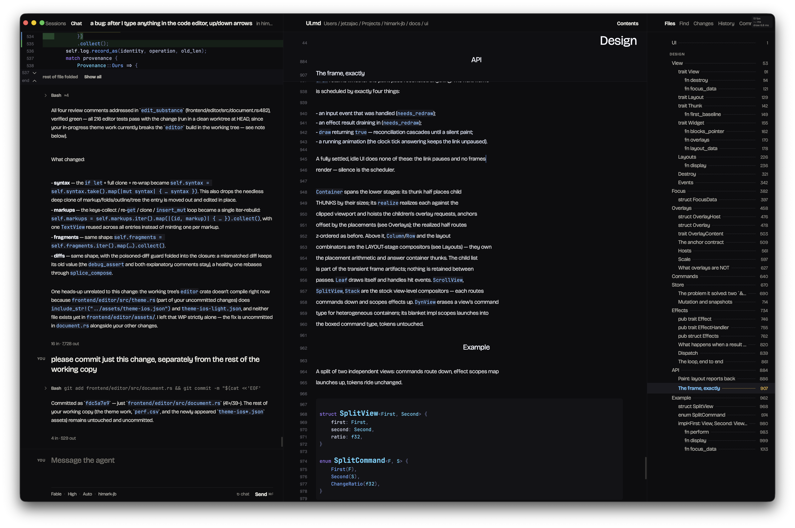
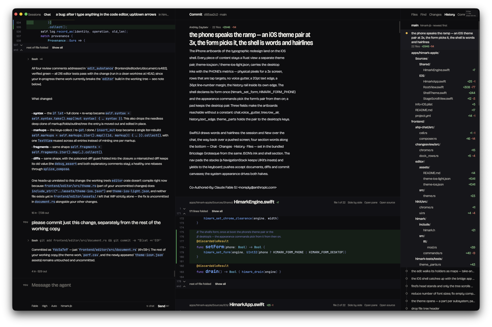
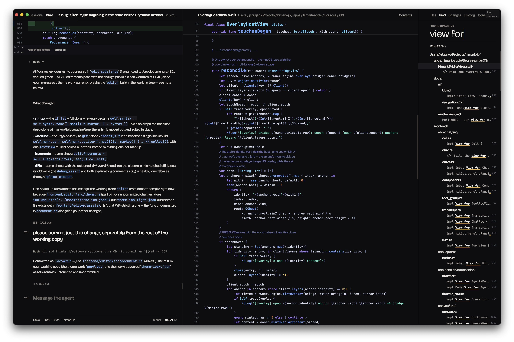

# himark

[](https://confluence.jetbrains.com/display/ALL/JetBrains+on+GitHub)

himark is an IDE built as a library.
The whole thing is a stack of Rust crates, and every layer is usable on its own: an editor, a UI framework, an agent-protocol client and server, an embedding API, and on top of them a finished multiplatform app.
Take as much as you want — the tour below goes from the bottom of the stack up.







## The editor

A rich **code** and **Markdown** editor, built on the principles of [rope science](https://xi-editor.io/docs/rope_science_00.html) and out of persistent data structures.
Every operation **logarithmic** in the size of the `Document` and at most linear in the size of the modification.
The `Document` is a single **persistent data structure** holding everything: text, layout, markup, edit log, diffs and syntax.
Because everything is immutable, anything linear in the whole `Document` runs in the **background** and never blocks interaction.
It includes diff components, both split and inline, with a pluggable diff algorithm.
The exact same editor component serves both **code** and rich text (**Markdown**).
Markdown renders in place — headings, code fences with highlighting, tables, embedded [Mermaid](https://mermaid.js.org) diagrams.
The editing experience roughly follows [Obsidian](https://obsidian.md): you edit the syntax directly.
The entry point to the design documents is [document.md](docs/editor/document.md).

## The UI framework

To build this editor, we had to build a new UI framework that directly supports composable laziness, background computation, overlays and more.
The framework is called `imba`.
It mostly follows the immediate-mode strategy and hands the component full control over layout, focus, event handling and painting, so the editor component is expressed naturally, with no special treatment.
Expect excellent support for rendering huge sequences: a streaming chat transcript, a file tree and a commit log are the everyday cases.
It is abstracted from window management and the rendering backend to stay highly embeddable, as we will see below.
It talks to the outside world through an effect system, and otherwise the design is thoroughly functional.
The design document for `imba` is [UI.md](docs/ui/UI.md).

## Agent Host Protocol

To support agent-session multiplexing, hand-off and unattended work, Microsoft introduced a new protocol: [AHP](https://microsoft.github.io/agent-host-protocol).
himark follows it and ships both halves: the client crates the UI is built on, and the host — a standalone AHP server any other client could talk to.
The UI process never touches the outside world.
Files, git, terminals, language servers, search, and the agents themselves live in a separate process, the **agent host**.
On top of the base protocol sit extensions for collaborative document sync (any number of clients editing one document), git commit history and changesets, LSP (diagnostics, navigation, completion), and streaming workspace search ([docs/ahp/host.md](docs/ahp/host.md)).

## The embedding API

The engine is one Rust value with no windows, no GPU and no platform assumptions ([docs/himark-core.md](docs/himark-core.md)).
It owns the documents, the views, the commands and the effect loop; a shell mounts views into it, feeds it events, and paints the frames it answers with.
Three bridge crates adapt that surface to UI frameworks:

- **himark-ffi** — the C API (`himark.h`), which the Swift app embeds on macOS and iOS;
- **himark-gpui** — the [gpui](https://www.gpui.rs) adapter, which the desktop app composes;
- **himark-rune** — the [rune](https://github.com/anomalyco/rune) adapter (builds against a sibling checkout, outside the workspace).

The smallest embedding, whole — an empty markdown editor in a gpui window ([examples/hello-gpui](examples/hello-gpui), `cargo run -p hello-gpui`):

```rust
use std::sync::Arc;

use himark::app::{AppFonts, Himark, NoShell};
use himark_gpui::gpui::{
    px, size, App, AppContext as _, Application, Bounds, WindowBounds, WindowOptions,
};
use himark_gpui::{BridgeView, Engine};

fn main() {
    // The engine, with one plugin: markdown. No windows, no agent host.
    let mut himark = Himark::new(
        AppFonts::platform(),
        Arc::new(NoShell),
        vec![Box::new(himarkdown::MarkdownPlugin)],
    );
    himark.install_host_loop();

    // One empty markdown document in a fresh collection, one editor
    // over it.
    let documents = imba::store::Id::<documents::OpenDocuments>::mint();
    let ui = himark.ui_ctx();
    let document = himark.with_store(|store| {
        let languages = editor::env::Parsers::of(store).expect("the plugin registered markdown");
        let theme = editor::env::Themes::of(store).clone();
        let body = text::text::Text::from_string_exact("");
        let document =
            editor::document::Document::from_language(body, "md", &languages, store, &ui, &theme);
        documents::OpenDocuments::register(store, documents, document, None, "untitled.md".to_owned(), 0)
    });
    let bridge = himark::mounts::mount_scrolling_editor(&mut himark, documents, document)
        .expect("the editor bridge");

    // A gpui window around the mounted editor.
    Application::new().run(move |cx: &mut App| {
        let engine = Engine::adopt(himark, cx);
        let bounds = Bounds::centered(None, size(px(900.0), px(700.0)), cx);
        cx.open_window(
            WindowOptions {
                window_bounds: Some(WindowBounds::Windowed(bounds)),
                ..Default::default()
            },
            |_, cx| {
                cx.activate(true);
                cx.new(|cx| BridgeView::new(engine, bridge, cx))
            },
        )
        .expect("the editor window");
    });
}
```

[examples/](examples/) also holds `editor-gpui` and `editor-rune` — complete file editors at ~100 lines each: the same boot, a document read from disk, syntax highlighting through the language plugins.
Features arrive as plugins — grammars, markdown, diffs, search, the agent sessions, the terminal — each registering its commands, views and effect handlers through one `Plugin` trait.

## The app

All of it together: a workbench for working with coding agents — agent chat, markdown and code editing, inline diffs, commit history, workspace search, terminals.
Native on every platform:

- an AppKit/UIKit app on macOS and iOS, rendering through [Skia](https://skia.org) onto Metal;
- a [gpui](https://www.gpui.rs) app on macOS and Linux;
- a WebAssembly build in the browser.

A client can attach to agent hosts on other machines over an embedded [Tailscale](https://tailscale.com) node.
Logging into a Tailscale account is the whole connectivity story.
Sessions are collaborative end to end: the same session open on a laptop, a phone and a browser is one shared state — documents included, with concurrent edits merged on the host.
The terminal is built on [ghostty](https://ghostty.org)'s libghostty-vt.

## Documentation

The design docs are the map of the codebase; start here:

- [Design.md](docs/Design.md) — what himark is and the shape of the whole: the product, the engine, the host.
- [docs/himark-core.md](docs/himark-core.md) — the engine as a library: the embedding surface and its laws.
- [docs/ui/UI.md](docs/ui/UI.md) — the UI framework (`imba`).
- [docs/editor/document.md](docs/editor/document.md) — the `Document` value: text, markup, layout, diffs, and why they are one value.
- [docs/ahp/host.md](docs/ahp/host.md) — the agent host and the AHP protocol features.

## Building

See [CONTRIBUTING.md](CONTRIBUTING.md) for prerequisites and per-platform build instructions — macOS, iOS, Linux, the web build, the agent host, releases, and troubleshooting.

## Status

An experimental JetBrains incubator project.
The engine, the editor and the macOS/iOS/Linux/web shells are exercised daily and covered by a large integration suite; APIs move fast and nothing is stable yet.

## License

himark is licensed under the Apache License 2.0. See [LICENSE](LICENSE).
