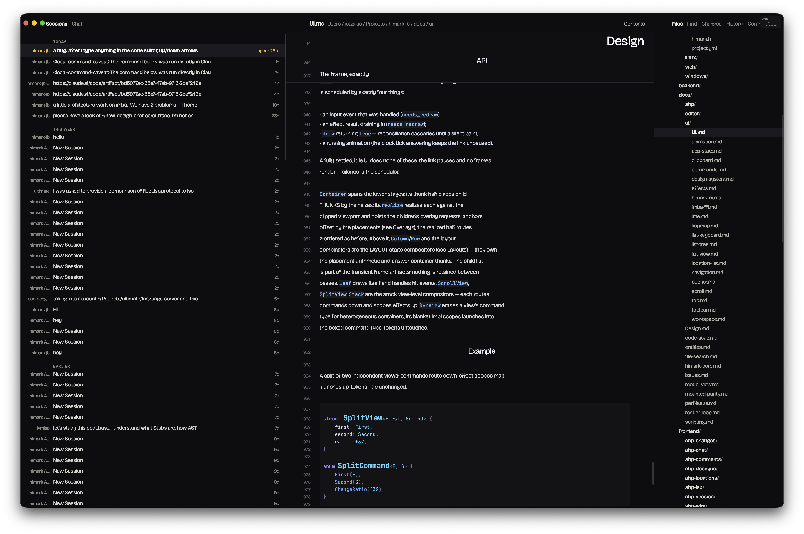
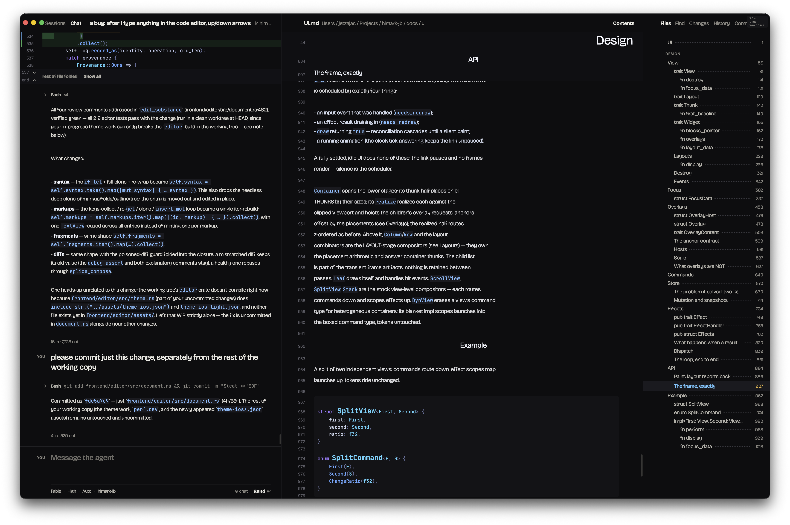
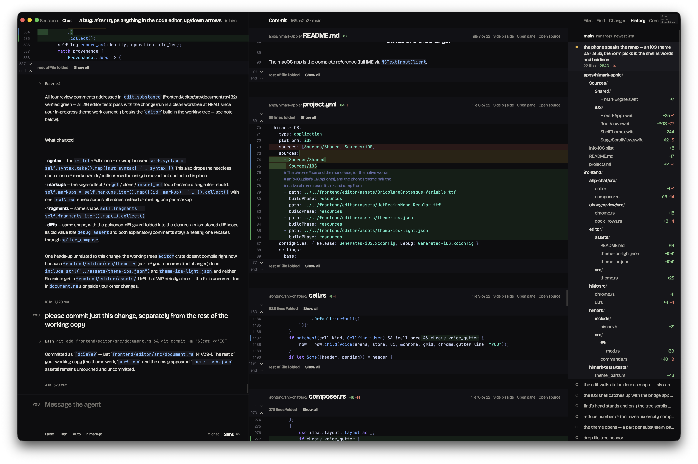
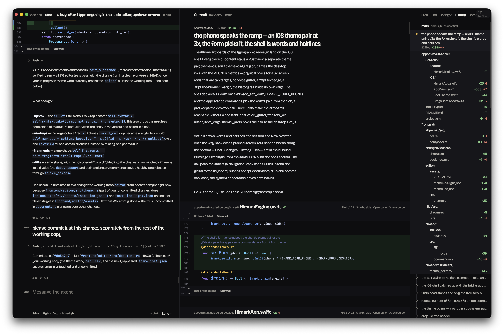
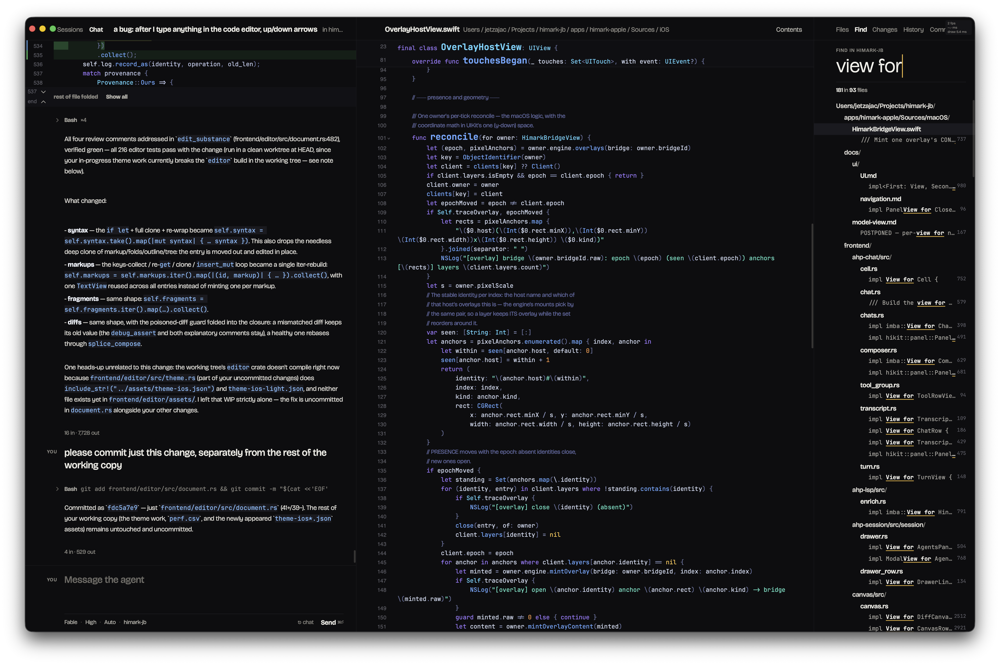
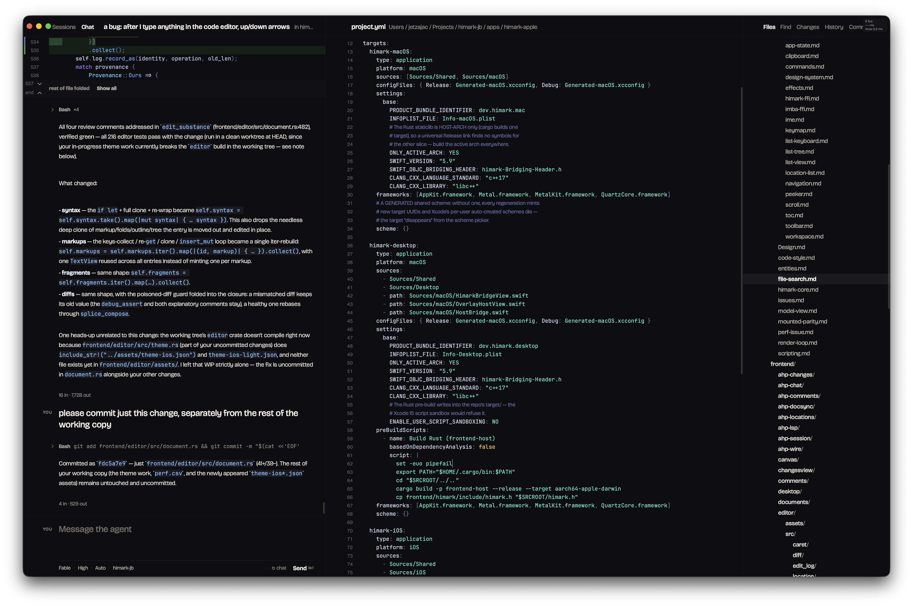

# himark

[](https://confluence.jetbrains.com/display/ALL/JetBrains+on+GitHub) 

himark is an experimental markdown editor and AHP client written in Rust. The app core is a
headless engine that renders through [Skia](https://skia.org) and is embedded
into a native shell on each platform: an AppKit/UIKit app on macOS and iOS, a
`winit` window on Linux and Windows, and a WebAssembly build in the browser.
A separate backend process, the **agent host**, owns everything that touches
the outside world: files, search, terminals, language servers, git, and
coding agents (Claude Code and Codex).

<p align="center">
  
  
</p>
<p align="center">
  
  
</p>
<p align="center">
  
  
</p>

## Repository layout

```
frontend/         the engine: rope, text, intervals, layout, editor, plugins,
                  and the shells' Rust halves (frontend-host, desktop, himark-winit)
frontend/plugins/ feature plugins (markdown, search, palette, peeker, diff, code)
frontend/plugins/lang/  one tree-sitter language plugin per folder
backend/          the agent host (himark-agent-host) and its services
protocol/         serde types shared by both sides, plus host discovery
apps/             platform shells: himark-apple (macOS + iOS), linux, windows, web
vendor/           patched skia-bindings and tree-sitter crates
```

## Documentation

The design docs are the map of the codebase; start here:

- [Design.md](docs/Design.md) — what himark is and the shape of the
  whole: the product, the engine, the host.
- [docs/ui/UI.md](docs/ui/UI.md) — the immediate-mode UI framework
  (`imba`), root of the UI family.
- [docs/editor/document.md](docs/editor/document.md) — the `Document`
  value, root of the editor family: text, markup, layout, diffs, and
  why they are one value.
- [docs/ahp/host.md](docs/ahp/host.md) — the agent host and the AHP
  protocol features.

## Building

See [CONTRIBUTING.md](CONTRIBUTING.md) for prerequisites, per-platform
build instructions, the agent host, releases, and troubleshooting.

## License

himark is licensed under the Apache License 2.0. See [LICENSE](LICENSE).
